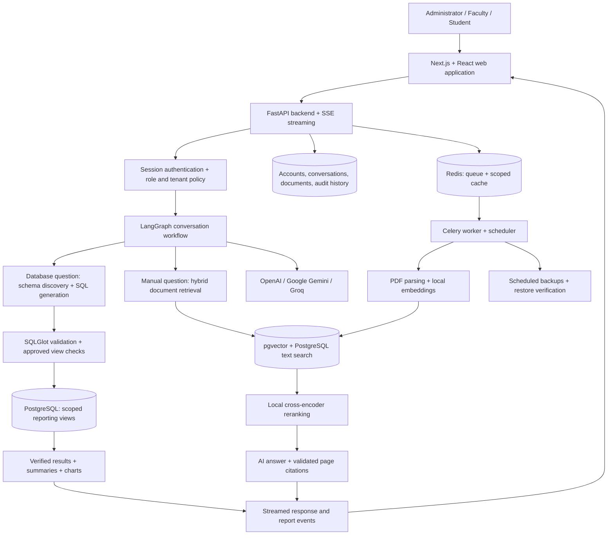

# School Insight

### AI-powered school analytics and knowledge assistant

School Insight is a full-stack web application that helps school administrators, faculty, and students get answers from school records and documentation through natural-language conversations. It connects a PostgreSQL school database with an AI assistant, turning questions into permission-scoped reports, interactive tables, charts, and explanations supported by manual citations.

Instead of navigating multiple screens or writing SQL, users can ask about attendance, examination results, timetables, homework, and leave records in one workspace. Each answer respects the signed-in user’s role and access to school data.

**[Open the live project on AWS →](http://65.2.57.197/chat)**

**Repository:** [y-abhiram/chatbot_school_insight](https://github.com/y-abhiram/chatbot_school_insight)

## Live application

The project is deployed on **AWS EC2** and is available at:

**http://65.2.57.197/chat**

Sign in with an account provisioned by the workspace administrator. Access depends on your role: administrators can explore school-wide reports, faculty can access their assigned academic records, and students can view their own information. Login credentials are shared privately.

## What the project does

School data and school procedures usually live in different places: structured database records and document-based manuals. School Insight brings both into a single conversational interface:

- **Database questions** become validated, read-only SQL queries against approved reporting views.
- **Procedure and policy questions** retrieve relevant manual passages and return answers with page citations.
- **Combined questions** use database results and documentation together.
- **Follow-up questions** use conversation context to explain or summarize previous results.

The application supports information retrieval, analysis, explanations, and drafting. Chat does not change school records, submit leave requests, or approve applications.

## Key features

| Feature | What users can do |
|---|---|
| Natural-language reporting | Ask questions about students, faculty, attendance, marks, timetables, homework, and leave |
| Document-grounded answers | Read explanations based on the school manual with original page references |
| Interactive reports | Search, sort, and paginate tables; inspect executed SQL; export CSV; view charts |
| Conversational workspace | Ask follow-ups, stream responses, stop generation, copy or regenerate answers, and submit feedback |
| Role-based access | Receive results filtered by authenticated identity and school responsibilities |
| Overview dashboard | Explore school metrics and report summaries alongside the chat workspace |
| Knowledge management | Upload PDFs, track indexing status, and inspect supporting documents |
| Conversation history | Revisit private conversations and executed-query history |
| AI provider selection | Choose configured OpenAI, Google Gemini, or Groq models |
| Account management | Change passwords; administrators provision accounts and issue setup or recovery links |
| Operations | Monitor health and readiness, run background jobs, and schedule backups with restore verification |
| Organisation onboarding | Connect separate organisation databases through reviewed reporting views and tenant-specific documents |

## User roles

| Role | Data access |
|---|---|
| Administrator | School-wide reports, source and schema inspection, document management, and account provisioning |
| Faculty | Assigned sections and subjects, permitted student records, and their own staff leave records |
| Student | Their own academic records, attendance, marks, homework, leave, and permitted section schedules |

Permissions are enforced by the backend and PostgreSQL reporting views. A role or identity claimed inside a chat message does not change access.

## System architecture



### How a question becomes an answer

1. The user signs in and submits a question through the chat interface.
2. The backend resolves the user’s identity, role, tenant, and permitted data scope.
3. LangGraph routes the request to database reporting, manual retrieval, or a combined workflow.
4. For database requests, generated SQL is checked against the discovered schema and approved views before execution in a read-only transaction.
5. For manual requests, vector and text search retrieve relevant passages; local reranking selects evidence for the answer.
6. The frontend receives response events and presents the answer with tables, charts, SQL details, or page citations as appropriate.
7. Conversations and successful query history are saved privately for the account.

### Data and security design

The source school database contains **29 tables and 4 original report views**. The application separates source records, permission-scoped reporting views, and application state into three schemas:

| Schema | Purpose |
|---|---|
| `school` | Original school records |
| `insight` | Approved reporting views with role and identity filters |
| `insight_app` | Accounts, sessions, conversations, documents, vector chunks, tenant configuration, and audit history |

Generated queries are treated as untrusted input. SQL validation restricts access to approved relations and columns, rejects writes, and applies execution timeouts and result limits. The query database account cannot read raw school tables or application metadata.

Passwords use Argon2 hashing. Sessions use hashed tokens and HttpOnly cookies. Password changes revoke existing sessions; setup and recovery links are single-use and expire after 15 minutes. Provider keys stay on the backend. LangSmith tracing is optional and disabled by default.

Cloud AI requests can include permitted schema, recent conversation context, and relevant manual excerpts. Provider selection and optional tracing should follow the organisation’s data-sharing policy.

## Project output

The main output is a browser-based school intelligence workspace: a conversational answer supported by the relevant records or documentation, with expandable evidence and exportable reports.

### Example: school-wide report

**Question:** “How many students are there?”

**Recorded administrator response:**

> There are 4 student records visible to your account under the requested filters.

| student_count |
|---|
| 4 |

The report includes the executed SQL and can be exported as CSV.

### Example: examination results

**Question:** “Show Kiran’s examination results.”

| Student | Subject | Marks | Grade |
|---|---|---|---|
| Kiran Patel | English | 82 | A |
| Kiran Patel | Mathematics | 88 | A |
| Kiran Patel | Science | 76 | B+ |

### Example: manual-based answer

**Question:** “What are the allowed student attendance statuses?”

The recorded answer identifies **Present, Absent, Late, and Excused**, explains that attendance is recorded per student, date, and period, and cites **page 13** of the school manual.

These examples come from the [saved evaluation results](docs/evaluation/acceptance-results.json) for the included sample database. Results depend on the signed-in role, available records, and current data.

### Questions to try

- “List all students and their sections.”
- “Show students below 75% attendance.”
- “Show the timetable for Grade 9-A.”
- “Which students have pending homework?”
- “Show pending leave requests.”
- “Explain the leave approval process.”
- “Summarize that report.”

## Technology stack

| Layer | Technologies |
|---|---|
| Frontend | Next.js 16, React 19, TypeScript, Recharts, Lucide icons |
| Backend | Python, FastAPI, Pydantic, SQLAlchemy |
| AI orchestration | LangGraph, LangChain |
| Model providers | OpenAI, Google Gemini, Groq |
| Database | PostgreSQL 17, pgvector |
| SQL validation | SQLGlot |
| Document processing | PyPDF, Sentence Transformers, local embeddings and cross-encoder reranking |
| Background processing | Redis, Celery worker, Celery Beat |
| Authentication | Argon2 password hashing, server-side sessions, role and tenant policies |
| Deployment | AWS EC2, Docker Compose, reverse proxy configuration |
| Verification | Pytest, browser checks, live provider evaluations, backup restore checks |

## Repository structure

```text
.
├── product/                       # Backend API, AI workflow, authentication, SQL and retrieval
├── web/                           # Next.js application, chat interface, dashboard and reports
├── scripts/                       # Bootstrap, migrations, ingestion, evaluations and operations
├── tests_product/                 # Automated backend and integration tests
├── docs/                          # Architecture, API, deployment and evaluation documentation
├── deploy/                        # Reverse proxy and service configuration
├── compose.yml                    # Local PostgreSQL and Redis services
├── compose.production.yml         # Production container stack
├── Dockerfile.backend
├── Dockerfile.frontend
├── requirements.txt
├── .env.example                   # Configuration template without secrets
├── school_management_postgres92.sql
└── School Management Database - User Manual.pdf
```

## Run locally

Prerequisites: Python with the dependencies in `requirements.txt`, a Node.js version compatible with Next.js 16, and Docker with Docker Compose. The first document ingestion downloads local embedding and reranking models.

### 1. Clone and install

```bash
git clone https://github.com/y-abhiram/chatbot_school_insight.git
cd chatbot_school_insight
python -m venv .venv
source .venv/bin/activate
python -m pip install -r requirements.txt
(cd web && npm ci)
```

### 2. Configure the AI provider

For a fresh checkout, copy `.env.example` to `.env`. Preserve an existing `.env` if one is already configured.

```bash
cp .env.example .env
python scripts/configure_ai.py
```

Configure at least one provider key and the exact model IDs available to your account. Provider keys and runtime credentials are excluded from Git.

### 3. Start PostgreSQL and Redis

Create a private local service password once:

```bash
python - <<'PYTHON'
from pathlib import Path
import os
import secrets

Path('.runtime').mkdir(exist_ok=True)
path = Path('.runtime/services.env')
if not path.exists():
    fd = os.open(path, os.O_WRONLY | os.O_CREAT | os.O_EXCL, 0o600)
    with os.fdopen(fd, 'w') as output:
        output.write('PRODUCT_POSTGRES_PASSWORD=' + secrets.token_urlsafe(36) + '\n')
PYTHON

docker compose --env-file .runtime/services.env -f compose.yml up -d --wait
```

### 4. Initialise the database and manual index

Run these commands only for a new local database:

```bash
python scripts/bootstrap_product.py
python scripts/ingest_manual.py
```

Bootstrap imports the included sample database, creates application accounts and reporting views, and writes private local credentials to `.runtime/demo-accounts.json`. The SQL dump recreates the `school` schema; use an isolated database. Bootstrap refuses to reset an existing school schema.

For an existing installation, apply additive updates with `python scripts/migrate_product.py`.

### 5. Start the application

Run each process in a separate terminal from the repository root. Activate `.venv` in each Python terminal.

| Process | Command |
|---|---|
| API | `python -m uvicorn product.api:app --host 127.0.0.1 --port 8100` |
| Frontend | `cd web && npm run build && npm run start` |
| Worker | `python -m celery -A product.jobs.celery worker --loglevel=warning --pool=solo --concurrency=1` |
| Scheduler | `python -m celery -A product.jobs.celery beat --loglevel=warning --schedule .runtime/celerybeat-schedule` |

Open **http://127.0.0.1:3000/chat**. The overview is at **http://127.0.0.1:3000/overview**, and backend API documentation is at **http://127.0.0.1:8100/api/docs**. Next.js proxies browser API requests to the backend.

The convenience shell scripts under `scripts/` use the original development machine’s Python path. The commands above use your activated environment directly.

## AWS deployment

The live AWS EC2 application is available at **[http://65.2.57.197/chat](http://65.2.57.197/chat)**.

For a separate deployment, follow the [EC2 deployment guide](docs/EC2_DEPLOYMENT.md). The repository includes a production Docker Compose stack, backend and frontend Dockerfiles, reverse proxy templates, persistent storage, secret-file configuration, and backup tooling. The guide also covers domain and HTTPS setup.

## Testing and recorded verification

Run the automated suite against the configured local services:

```bash
python -m pytest tests_product -q
```

Additional checks:

```bash
(cd web && npm run typecheck && npm run build)
python scripts/check_operations.py
python scripts/backup_product.py --verify-restore
```

The [saved verification report](docs/verification.json) records **86 passing automated tests**, **48 browser checks**, and **17/17 required question checks** across OpenAI and Gemini, alongside streaming, frontend build, and backup restore verification. These are recorded results from that run; see the [evaluation guide](docs/EVALUATION.md) to repeat evaluations. Live AI evaluations require configured provider access and consume API quota.

## Further documentation

| Guide | Contents |
|---|---|
| [Architecture](docs/ARCHITECTURE.md) | Modules, data boundaries, SQL safeguards, retrieval, and streaming |
| [API](docs/API.md) | Backend endpoints and streaming protocol |
| [Role access](docs/CHAT_ACCESS.md) | Student, faculty, and administrator capabilities |
| [AWS EC2 deployment](docs/EC2_DEPLOYMENT.md) | Production setup, secrets, persistence, domain, and HTTPS |
| [Operations](docs/OPERATIONS.md) | Service management, monitoring, backups, and restoration |
| [Organisation onboarding](docs/ONBOARDING.md) | Connecting another organisation’s database and documents |
| [Evaluation](docs/EVALUATION.md) | Expected-result methodology and saved evidence |

## Author

Developed by **[Yalla Abhiram Chowdary](https://github.com/y-abhiram)**.
