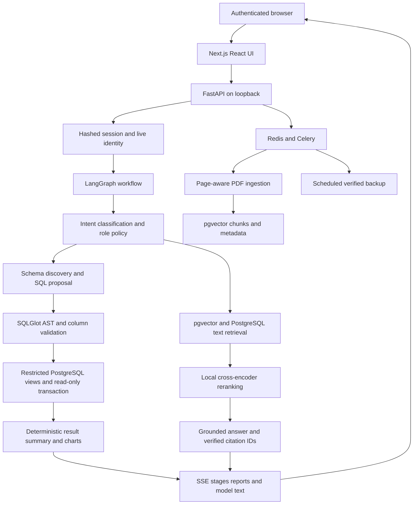

# Architecture

## Modules

| Module | Responsibility |
|---|---|
| `product/api.py` | HTTP routes, strict input schemas, stream protocol, conversation ownership |
| `product/auth.py`, `accounts.py` | Session authentication, source identity, password and account lifecycle |
| `product/policy.py` | Verified welcome, role capabilities, deterministic permission responses |
| `product/agent.py` | Graph routing, bounded SQL repair, tool execution and response construction |
| `product/llm.py`, `providers.py` | Provider configuration, adapters and partial structured-output streaming |
| `product/sql_engine.py` | PostgreSQL catalogue, SQL validation and isolated query transactions |
| `product/rag.py`, `jobs.py` | PDF parsing, chunking, embeddings, retrieval, reranking, asynchronous jobs |
| `product/sources.py`, `storage.py` | Tenant source registry and separate database engines |
| `product/cache.py` | Identity-scoped Redis cache; only Admin SQL reports are cached |
| `product/observability.py` | Content-free logs, metrics and tenant audit events |
| `product/evaluation.py`, `langsmith_eval.py` | Independent reference validation and opt-in remote evaluation publication |
| `web/components/` | Chat, reports, overview, account and management UI |

## Data boundaries

The supplied data remains in `school`. Permission-scoped, redacted views live in `insight`. Application accounts, session hashes, messages, query history, documents, vector chunks and tenant registry live in `insight_app`. The model query login can select approved report views; it cannot read the source tables or app metadata. The API service login handles control metadata. Database administrator credentials are used only by local bootstrap/migration/backup tools.

A generated query is untrusted. Validation permits one bounded SELECT, checks every relation and column against the discovered tenant catalogue, rejects writes/locks/set operations, restricts functions and casts, and qualifies approved views. Execution sets the authenticated tenant/role/source user ID inside a read-only transaction, with a 3-second statement timeout, 500 ms lock timeout and safe search path. Views use `security_barrier=true`. Role filters come from authenticated server state, never from a chat claim.

Students read their own private records and shared schedules for their section. Faculty see students in assigned sections and marks/attendance for assigned subjects; leave access is their own requests. Admin access is school-wide. Authentication rechecks school identity and active status; external tenants recheck their own directory on every authenticated request. Non-Admin result caching is disabled so permission revocations take effect immediately.

SQL validation or execution can trigger only one repair attempt; every replacement query passes validation again. Outputs are limited to 200 rows with a truncation indicator. Empty results remain empty. Recorded marks use stored grade/result rules; missing marks are not treated as failure. Attendance counts Present + Late over recorded periods, rather than assuming every calendar day is present in the sample.

## Documents and streaming

PDF ingestion preserves physical page numbers and section metadata, uses 1,400-character chunks with 220-character overlap, and produces local MiniLM 384-dimensional embeddings. Retrieval combines independent vector and lexical candidates with reciprocal-rank fusion, then reranks the best candidates locally. Only chunks from the authenticated tenant's ready documents are eligible. Final citation IDs must exist in the retrieved evidence. A citation verifies provenance; no probabilistic model can guarantee every interpretation, so the source excerpt is inspectable.

LangChain partial JSON objects yield actual newly generated answer text through graph custom events. The API forwards these as `answer_delta`; it does not animate a completed answer. SQL summaries are deterministic and appear after successful tool execution. Final validated results replace provisional streamed text; errors remain visible and are not saved as successful assistant answers.

## State and privacy

Sessions last eight hours, store only token hashes, and use HttpOnly SameSite=Strict cookies (Secure under HTTPS). Passwords use Argon2. Recovery tokens are random, hashed, expire after 15 minutes and are consumed transactionally; password changes revoke all sessions. Origin checks and body size limits apply to mutations. Account provisioning derives roles from a verified source directory.

Conversations and feedback are account/tenant-owned. Provider/model changes require a new conversation. Operational logs omit request bodies, questions, SQL, secrets and provider exception strings. Stored private conversation/query history intentionally contains user questions and answers; audit/backup access needs the same protection as the database. LangSmith tracing/publication is opt-in and sends data outside this installation.

## Extensibility

The source registry selects a tenant's own connection, reporting schema, catalogue and role capability manifest. Generic sources do not run school-specific deterministic queries or profile lookups. A second business database is exercised by integration tests without changing the graph or SQL engine. A trusted operator must prepare and review identity-scoped views; onboarding a raw database cannot safely infer its business permissions automatically.
